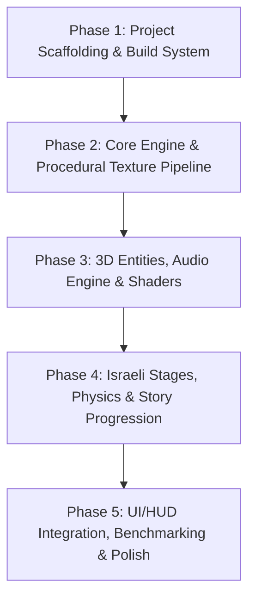

# Architectural Blueprint & Vite Modularization Plan
## Project: פלאפלוצ'יק וחומוסון: המסע להצלת הפיתה הגדולה (Falafel 3D)

**Document Version:** 1.0.0  
**Target Architecture:** TypeScript + Vite 5 + Three.js (ESM) + Modular Game Engine  
**Source Artifact:** `code_artifact.html` (4,126 lines monolithic single-file HTML/JS)

---

## 1. Executive Summary & Codebase Audit

The existing game is an ambitious, charming, and feature-rich 3D browser game packed into a single 4,126-line HTML file. It runs Three.js r128 via CDN, uses the Web Audio API for 100% procedural soundtrack and sound effects, generates all diffuse/bump/roughness textures procedurally via 2D `<canvas>` elements, and implements custom physics for squash-and-stretch jelly deformation, drag-and-throw trajectory calculation, and spring-based environmental sway.

### Identified Bottlenecks in Monolithic Architecture
1. **WebGL Memory Leaks (Missing Disposal)**:
   - When switching environments in `buildEnv()`, `clearEnv()` calls `envGroup.remove(...)` without calling `.dispose()` on geometries, materials, or textures. Switching stages leaks GPU buffers.
   - Dynamic particles (`spawnWaterRipple`, `spawnSparkles`, `spawnDust`) and projectile crumbs create `new THREE.Mesh()` and clone materials per spawn, releasing them via `scene.remove()` without disposal or object pooling.
2. **Global Variable Explosion**: Over 70 global state variables live in a single IIFE closure (`audioCtx`, `jellyScaleY`, `isGrabbing`, `storyStageIdx`, `kotelDoves`, `flyingCrumbs`, etc.), creating tight coupling between audio, rendering, DOM events, and physics.
3. **Implicit DOM Coupling**: 3D physics directly queries `window.innerWidth`, DOM elements are queried imperatively across multiple modules, and state transitions directly manipulate class names.
4. **Lack of Type Safety & Tree-Shaking**: Global Three.js r128 CDN script disables dead-code elimination, TypeScript checking, and modern bundler asset pipelines.

---

## 2. Directory & Module Structure

The project will be organized into a modern, industry-standard game architecture separating **Core Engine**, **Scene Hierarchy**, **Entities**, **Audio**, **Physics**, **Systems**, **Shaders**, and **UI**:

```text
falafel-game/
├── package.json
├── tsconfig.json
├── vite.config.ts
├── index.html
├── public/
│   ├── favicon.ico
│   └── icons/                 # SVG UI icons extracted from HTML
├── src/
│   ├── main.ts                # Application entrypoint & bootloader
│   │
│   ├── core/                  # Core Engine Infrastructure
│   │   ├── Engine.ts          # Main Game loop, ticker, RAF coordinator
│   │   ├── EventBus.ts        # Strongly-typed pub/sub event bus
│   │   ├── StateMachine.ts    # Generic state machine (modes, stages)
│   │   ├── Time.ts            # Delta time, elapsed time, scale, throttling
│   │   └── Disposable.ts      # Memory management & WebGL disposal interfaces
│   │
│   ├── rendering/             # Three.js Rendering Pipeline
│   │   ├── RendererManager.ts # WebGLRenderer, shadow map, tone mapping, DPR
│   │   ├── CameraManager.ts   # Responsive FOV, aspect ratio, camera transitions
│   │   ├── LightingManager.ts # Hemisphere, directional sun, rim, point lights
│   │   ├── SkyDome.ts         # Procedural sky shader material & dome mesh
│   │   └── ControlsManager.ts # OrbitControls wrapper with lock/unlock API
│   │
│   ├── entities/              # 3D Game Objects & Characters
│   │   ├── falafel/           # Main Hero "Falafeltchik"
│   │   │   ├── FalafelHero.ts      # Entity root & coordinator
│   │   │   ├── FalafelBody.ts      # Deformed sphere, sesame seeds, parsley
│   │   │   ├── FalafelFace.ts      # Cartoon eyes, blinking eyelids, eyebrows, mouth
│   │   │   ├── FalafelAccessories.ts # Headband (with tail flutter), backpack, salad
│   │   │   └── FalafelLimbs.ts     # Rigged arms with sweatbands, legs with shoes
│   │   ├── hummuson/          # Companion "Hummuson"
│   │   │   ├── HummusonEntity.ts   # Ping-pong sized chickpea, eyes, tiny feet
│   │   │   ├── ShadowCage.ts       # Rotating icosahedron cage & energy ring
│   │   │   └── FinaleBench.ts      # Park bench & giant pita resting pocket
│   │   ├── villain/           # Comedic Antagonist "Crumb King"
│   │   │   ├── CrumbKingEntity.ts  # Body, cape, mustache, wobble physics
│   │   │   ├── KingCostumes.ts     # Snorkel/goggles, rod, tembel hat, crown
│   │   │   └── FlyingCrumbPool.ts  # Pooled crumb projectile system
│   │   └── items/
│   │       └── StarCollectible.ts  # Dual-tetrahedron 3D star with halo
│   │
│   ├── environments/          # Israeli Locations & Stage Generators
│   │   ├── EnvironmentManager.ts # Environment switching, transitions, fog
│   │   ├── GroundTrack.ts     # Endless scrolling sandy trail & pebbles
│   │   ├── stages/
│   │   │   ├── JaffaStage.ts       # Clock tower, Mediterranean sea, sailboats, cats
│   │   │   ├── KinneretStage.ts    # Sea of Galilee, dynamic water shader, ducks, pier
│   │   │   ├── MasadaStage.ts      # Judean desert fortress, cliffs, acacia, ibex
│   │   │   └── KotelStage.ts       # Western Wall, Herodian stone, Kvitlach, doves
│   │   └── props/
│   │       ├── Foliage.ts          # Procedural palms, olive trees, scrub tufts
│   │       └── Fauna.ts            # Doves, gulls, sailboat animations
│   │
│   ├── physics/               # Custom Physics & Kinematics
│   │   ├── JellySpring.ts     # Volume-preserving squash & stretch spring
│   │   ├── TiltSpring.ts      # Dual-axis inertia tilts
│   │   ├── DragThrowPhysics.ts# Plane raycasting, drag history, ballistic throw
│   │   └── InteractionRaycaster.ts # Tap-to-interact dispatch system
│   │
│   ├── particles/             # High-Performance Particle Engine
│   │   ├── ParticleSystem.ts  # Unified pooled particle system
│   │   ├── DustEmitter.ts     # Ground running/jump dust puffs
│   │   ├── SparkleEmitter.ts  # Octahedron sparkle bursts
│   │   └── RippleEmitter.ts   # Water ring meshes & splash droplets
│   │
│   ├── audio/                 # Procedural Web Audio Engine
│   │   ├── AudioEngine.ts     # AudioContext lifecycle, master gain, echo delay bus
│   │   ├── SynthInstruments.ts# Procedural Oud, Harp, Flute, Cello voices
│   │   ├── PercussionSynth.ts # Darbuka Dum & Tek physical modeling
│   │   ├── AmbientGenerator.ts# Filtered noise + LFO (coastal breeze, lake waves)
│   │   ├── Soundscapes.ts     # Melodic score phrases & foley timers per stage
│   │   └── SoundEffects.ts    # Boing, plop, meow, quack, fanfare, stone taps
│   │
│   ├── textures/              # Procedural Canvas Texture Generators
│   │   ├── TextureManager.ts  # Cached canvas textures & GPU upload manager
│   │   ├── FalafelTexture.ts  # Diffuse, bump, roughness canvas generator
│   │   ├── FlagTexture.ts     # Israeli flag headband canvas generator
│   │   ├── SandTexture.ts     # Desert sand track canvas generator
│   │   ├── StoneTexture.ts    # Herodian stone canvas generator
│   │   └── PitaTexture.ts     # Baked pita bread canvas generator
│   │
│   ├── shaders/               # Custom GLSL Shaders
│   │   ├── SkyShader.ts       # Gradient hemisphere sky with sun spot
│   │   └── WaterShader.ts     # Sinusoidal wave displacement & shore foam
│   │
│   ├── story/                 # Level Progression & Lore
│   │   ├── StoryController.ts # 4-stage rescue progression coordinator
│   │   └── StoryData.ts       # Hebrew lore, stage metadata, star coordinates
│   │
│   ├── ui/                    # UI / HUD System
│   │   ├── UIManager.ts       # DOM overlay coordinator & binding
│   │   ├── StoryModal.ts      # Narrative cards & dialogs
│   │   ├── ToastView.ts       # Location toast pill
│   │   └── components/
│   │       ├── StoryPill.ts   # Star progress counter & stage dots
│   │       ├── LocationBar.ts # Stage selection buttons
│   │       └── MotionBar.ts   # Run / Sit / Roll / Jump buttons
│   │
│   └── types/
│       ├── game.types.ts      # Motion modes, stages, interaction types
│       └── events.types.ts    # Strongly typed event payloads
```

---

## 3. Clean Separation of Concerns & Class Interfaces

### 3.1 Rendering, Camera & Lighting Architecture

```typescript
// src/rendering/RendererManager.ts
export class RendererManager implements IDisposable {
  public readonly renderer: THREE.WebGLRenderer;

  constructor(container: HTMLElement) {
    this.renderer = new THREE.WebGLRenderer({
      antialias: true,
      alpha: false,
      powerPreference: 'high-performance'
    });
    this.renderer.setPixelRatio(Math.min(window.devicePixelRatio || 1, 2));
    this.renderer.setSize(window.innerWidth, window.innerHeight);
    this.renderer.outputColorSpace = THREE.SRGBColorSpace;
    this.renderer.toneMapping = THREE.ACESFilmicToneMapping;
    this.renderer.toneMappingExposure = 1.08;
    this.renderer.shadowMap.enabled = true;
    this.renderer.shadowMap.type = THREE.PCFSoftShadowMap;
    container.appendChild(this.renderer.domElement);
  }

  public resize(width: number, height: number): void {
    this.renderer.setSize(width, height);
  }

  public dispose(): void {
    this.renderer.dispose();
    this.renderer.domElement.remove();
  }
}
```

```typescript
// src/rendering/CameraManager.ts
export class CameraManager {
  public readonly camera: THREE.PerspectiveCamera;
  public readonly controls: OrbitControls;

  constructor(domElement: HTMLElement) {
    this.camera = new THREE.PerspectiveCamera(42, window.innerWidth / window.innerHeight, 0.1, 160);
    this.controls = new OrbitControls(this.camera, domElement);
    this.setupControls();
  }

  private setupControls(): void {
    this.controls.enableDamping = true;
    this.controls.dampingFactor = 0.08;
    this.controls.enablePan = false;
    this.controls.minDistance = 2.4;
    this.controls.maxDistance = 8.5;
    this.controls.minPolarAngle = 0.25;
    this.controls.maxPolarAngle = Math.PI * 0.48;
    this.controls.target.set(0, 0.95, 0);
  }

  public updateResponsive(resetPosition = false): void {
    const aspect = window.innerWidth / window.innerHeight;
    this.camera.aspect = aspect;
    if (aspect < 0.75) this.camera.fov = 48;       // Mobile portrait
    else if (aspect < 1.1) this.camera.fov = 44;   // Tablet
    else this.camera.fov = 38;                     // Desktop landscape
    this.camera.updateProjectionMatrix();

    if (resetPosition) {
      const dir = new THREE.Vector3(0.46, 0.28, 0.84).normalize();
      this.controls.target.set(0, 0.98, 0);
      this.camera.position.copy(this.controls.target).addScaledVector(dir, this.controls.maxDistance);
      this.controls.update();
    }
  }

  public update(): void {
    this.controls.update();
  }
}
```

### 3.2 Character Hierarchy & Procedural Animation Rigging

The main character **פלאפלוצ'יק** is refactored into modular sub-assemblies under a unified `FalafelHero` class. Volume-preserving jelly spring physics acts on `physicsGroup`, preserving volume via $scaleXZ = 1 / \sqrt{scaleY}$.

```typescript
// src/entities/falafel/FalafelHero.ts
export class FalafelHero extends THREE.Group implements IUpdatable, IDisposable {
  public readonly rootGroup = new THREE.Group();
  public readonly physicsGroup = new THREE.Group();
  public readonly bodyCenter = new THREE.Group();

  public readonly body: FalafelBody;
  public readonly face: FalafelFace;
  public readonly accessories: FalafelAccessories;
  public readonly limbs: FalafelLimbs;

  private readonly jellySpring = new JellySpring(145, 9.5);
  private readonly tiltSpring = new TiltSpring(120, 9.0);

  constructor(textureManager: TextureManager) {
    super();
    this.add(this.rootGroup);
    this.rootGroup.add(this.physicsGroup);
    this.bodyCenter.position.set(0, 1.05, 0);
    this.physicsGroup.add(this.bodyCenter);

    this.body = new FalafelBody(textureManager, this.bodyCenter);
    this.face = new FalafelFace(this.bodyCenter);
    this.accessories = new FalafelAccessories(textureManager, this.bodyCenter);
    this.limbs = new FalafelLimbs(this.bodyCenter);
  }

  public update(dt: number, elapsed: number, mode: MotionMode, isGrounded: boolean): void {
    // 1. Update jelly spring & tilt
    const { scaleY, invXZ, tiltX, tiltZ } = this.jellySpring.update(dt);
    this.physicsGroup.scale.set(invXZ, scaleY, invXZ);
    this.physicsGroup.rotation.set(tiltX, 0, tiltZ);

    // 2. Animate locomotion poses per mode (run, sit, roll)
    this.limbs.animate(dt, elapsed, mode, isGrounded);
    this.face.updateBlinkAndBrow(dt);
    this.accessories.updateFlutter(dt, elapsed, mode);
  }

  public applyImpulse(strength: number, dirX = 0, dirZ = 0): void {
    this.jellySpring.applyImpulse(strength);
    this.tiltSpring.applyTilt(dirX * strength, dirZ * strength);
    this.face.triggerSurprise(0.45);
  }

  public dispose(): void {
    this.body.dispose();
    this.face.dispose();
    this.accessories.dispose();
    this.limbs.dispose();
  }
}
```

### 3.3 Procedural Audio Synthesis Architecture

The Web Audio API procedural sound engine is split into isolated synth nodes, melodic sequencers, and an ambient noise/LFO generator, routed through a warm feedback delay bus:

```typescript
// src/audio/AudioEngine.ts
export class AudioEngine {
  private ctx: AudioContext | null = null;
  private masterGain: GainNode | null = null;
  private stageGain: GainNode | null = null;
  private echoBus: EchoDelayBus | null = null;
  private isMuted = false;

  public init(): void {
    if (this.ctx) return;
    const AudioCtxClass = window.AudioContext || (window as unknown as { webkitAudioContext: typeof AudioContext }).webkitAudioContext;
    this.ctx = new AudioCtxClass();

    this.masterGain = this.ctx.createGain();
    this.masterGain.connect(this.ctx.destination);

    this.stageGain = this.ctx.createGain();
    this.stageGain.connect(this.masterGain);

    this.echoBus = new EchoDelayBus(this.ctx, this.stageGain);
  }

  public playNote(freq: number, duration: number, voice: 'oud' | 'harp' | 'flute' | 'cello'): void {
    if (this.isMuted || !this.ctx || !this.echoBus) return;
    SynthInstruments.play(this.ctx, this.echoBus.inputNode, freq, duration, voice);
  }

  public playDrum(type: 'dum' | 'tek'): void {
    if (this.isMuted || !this.ctx || !this.stageGain) return;
    PercussionSynth.play(this.ctx, this.stageGain, type);
  }

  public setMuted(muted: boolean): void {
    this.isMuted = muted;
    if (this.masterGain && this.ctx) {
      this.masterGain.gain.setValueAtTime(muted ? 0 : 1, this.ctx.currentTime);
    }
  }
}
```

### 3.4 Interaction & Throw Physics Engine

Separates screen-space raycasting from physics integration:

```typescript
// src/physics/DragThrowPhysics.ts
export class DragThrowPhysics {
  private isGrabbing = false;
  private isThrown = false;
  private velocity = new THREE.Vector3();
  private grabPlane = new THREE.Plane();
  private grabOffset = new THREE.Vector3();
  private throwHistory: Array<{ pos: THREE.Vector3; time: number }> = [];

  public onPointerDown(ray: THREE.Ray, target: THREE.Object3D, cameraDir: THREE.Vector3): boolean {
    // Intersect hero bounding box
    // Setup grab plane perpendicular to camera direction
  }

  public onPointerMove(ray: THREE.Ray, target: THREE.Object3D): void {
    // Move along grabPlane, clamp bounds [-3.2, 3.2]
    // Record timestamped velocity history
  }

  public onPointerUp(): { thrown: boolean; velocity: THREE.Vector3 } {
    // Calculate final throw vector from last 5 samples
    // Trigger whoosh SFX if velocity > 2.2
  }

  public update(dt: number, heroPosition: THREE.Vector3, onBounce: () => void): void {
    if (!this.isThrown) return;
    this.velocity.y -= 17.5 * dt; // Gravity
    heroPosition.addScaledVector(this.velocity, dt);

    // Lateral wall bounces
    if (Math.abs(heroPosition.x) > 3.2) {
      heroPosition.x = Math.sign(heroPosition.x) * 3.2;
      this.velocity.x *= -0.58;
    }
    // Ground collision & squash bounce
    if (heroPosition.y <= 0) {
      heroPosition.y = 0;
      if (Math.abs(this.velocity.y) > 1.8) {
        this.velocity.y *= -0.5;
        this.velocity.x *= 0.72;
        this.velocity.z *= 0.72;
        onBounce();
      } else {
        this.velocity.set(0, 0, 0);
        this.isThrown = false;
      }
    }
  }
}
```

---

## 4. Vite Configuration, Build Pipeline & Dependencies

### 4.1 Dependency Stack (`package.json`)
```json
{
  "name": "falafel-3d-rescue",
  "version": "1.0.0",
  "type": "module",
  "scripts": {
    "dev": "vite",
    "build": "tsc && vite build",
    "preview": "vite preview",
    "lint": "eslint src --ext .ts"
  },
  "dependencies": {
    "three": "^0.160.0"
  },
  "devDependencies": {
    "@types/three": "^0.160.0",
    "typescript": "^5.3.3",
    "vite": "^5.0.12",
    "vite-plugin-glsl": "^1.2.1",
    "lil-gui": "^0.19.1"
  }
}
```

### 4.2 Optimized Vite Configuration (`vite.config.ts`)
```typescript
import { defineConfig } from 'vite';
import glsl from 'vite-plugin-glsl';
import path from 'path';

export default defineConfig({
  plugins: [glsl()],
  resolve: {
    alias: {
      '@': path.resolve(__dirname, './src')
    }
  },
  build: {
    target: 'es2022',
    sourcemap: true,
    minify: 'terser',
    terserOptions: {
      compress: {
        drop_console: false, // Keep debug logs in dev
        drop_debugger: true
      }
    },
    rollupOptions: {
      output: {
        manualChunks: {
          three: ['three'],
          controls: ['three/examples/jsm/controls/OrbitControls.js']
        }
      }
    }
  },
  server: {
    host: true,
    port: 3000
  }
});
```

---

## 5. Game Loop & Lifecycle: Complete WebGL Cleanup Architecture

To guarantee zero WebGL memory leaks during stage switching and game resets, every entity and stage implements `IDisposable`:

```typescript
// src/core/Disposable.ts
export interface IDisposable {
  dispose(): void;
}

export class WebGLDisposer {
  public static disposeObject(obj: THREE.Object3D): void {
    obj.traverse((child) => {
      if ((child as THREE.Mesh).isMesh) {
        const mesh = child as THREE.Mesh;
        if (mesh.geometry) {
          mesh.geometry.dispose();
        }
        if (mesh.material) {
          if (Array.isArray(mesh.material)) {
            mesh.material.forEach((mat) => WebGLDisposer.disposeMaterial(mat));
          } else {
            WebGLDisposer.disposeMaterial(mesh.material);
          }
        }
      }
    });
  }

  private static disposeMaterial(mat: THREE.Material): void {
    mat.dispose();
    for (const key of Object.keys(mat)) {
      const val = (mat as Record<string, unknown>)[key];
      if (val && typeof val === 'object' && (val as THREE.Texture).isTexture) {
        (val as THREE.Texture).dispose();
      }
    }
  }
}
```

### Object Pooling for Particles & Projectiles
Instead of instantiating `new THREE.Mesh` on every footstep, ripple, and thrown crumb, the modular architecture creates pre-allocated arrays in `ParticlePool`:
- `DustParticlePool`: 64 pre-allocated spheres with shared geometry and dynamic opacity.
- `SparkleParticlePool`: 32 pre-allocated octahedrons with shared geometry.
- `WaterRipplePool`: 16 pre-allocated ring meshes.
- `FlyingCrumbPool`: 12 pre-allocated crumb projectiles for the Crumb King fight.

---

## 6. Step-by-Step Phased Migration Plan

To guarantee **zero feature regression** and uninterrupted playability, migration is structured in 5 discrete phases:



### Phase 1: Project Scaffolding & Tooling Setup
1. Initialize Vite project with TypeScript (`package.json`, `tsconfig.json`, `vite.config.ts`).
2. Install `three`, `@types/three`, and `vite-plugin-glsl`.
3. Extract CSS styles from `code_artifact.html` into `src/ui/styles/game.css`.
4. Create semantic DOM overlay in `index.html` with accessibility labels and RTL Hebrew typography.

### Phase 2: Core Engine & Procedural Asset Pipeline
1. Implement `Engine.ts`, `Time.ts`, `EventBus.ts`, and `Disposable.ts`.
2. Port procedural texture canvas generators (`makeFalafelTextures`, `makeFlagHeadbandTexture`, `makeSandTrackTexture`, `makeStoneTexture`, `makePitaTexture`) into `TextureManager.ts` with GPU texture caching.
3. Validate textures render crisply in a Vite sandbox.

### Phase 3: 3D Character Rigging & Audio Engine
1. Refactor **פלאפלוצ'יק** into `FalafelHero` hierarchy (Body, Face with blinking eyelids, Flag Headband with fluttering tails, Hiking Backpack, Salad, Limbs).
2. Refactor **חומוסון** into `HummusonEntity` (chickpea body, big shiny eyes, joyful hop/spin state, shadow cage).
3. Refactor **מלך הפירורים** into `CrumbKingEntity` with stage costumes (Jaffa diving goggles, Kinneret fishing rod, Masada tembel hat, Jerusalem crown).
4. Port procedural Web Audio synthesis into `AudioEngine`, `SynthInstruments` (oud, harp, flute, cello), `PercussionSynth`, and Foley generators.

### Phase 4: Stage Environments, Physics & Story State Machine
1. Implement GLSL Shaders: `SkyShader.ts` (never-black sky dome) and `WaterShader.ts` (wave displacement & foam edge).
2. Port the 4 Israeli stages (`JaffaStage`, `KinneretStage`, `MasadaStage`, `KotelStage`) with proper `dispose()` logic in `EnvironmentManager`.
3. Wire up `DragThrowPhysics` (raycast plane dragging, throw inertia, lateral bounces, ground squash).
4. Implement `StoryController` coordinating the 4-stage rescue campaign, star collectibles, cage unlocking, and the Jerusalem grand finale.

### Phase 5: UI HUD, Verification & Zero-Regression QA
1. Connect HUD controls (Run, Sit, Roll, Jump, Location selector, Sound toggle, Story info, Story replay) via `UIManager` and `EventBus`.
2. Connect Hebrew location toast pills and narrative story modals.
3. Perform memory profiling in Chrome DevTools to confirm zero geometry/material memory leaks over 20+ stage switches.
4. Verify complete parity with `code_artifact.html` across visual rendering, motion physics, audio synthesis, and interactive easter eggs.

---

## 7. Deliverables & Next Steps

With this architecture blueprint in place:
1. The project structure is clearly defined.
2. WebGL resource leaks are systematically eliminated.
3. Physics, rendering, audio, and UI are fully decoupled.
4. Full type safety is achieved with modern TypeScript.
5. The game is ready for automated builds, hot module reloading (HMR), and production bundling.
